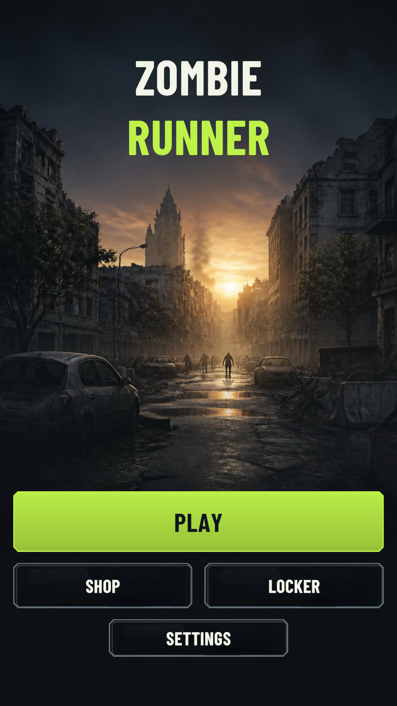
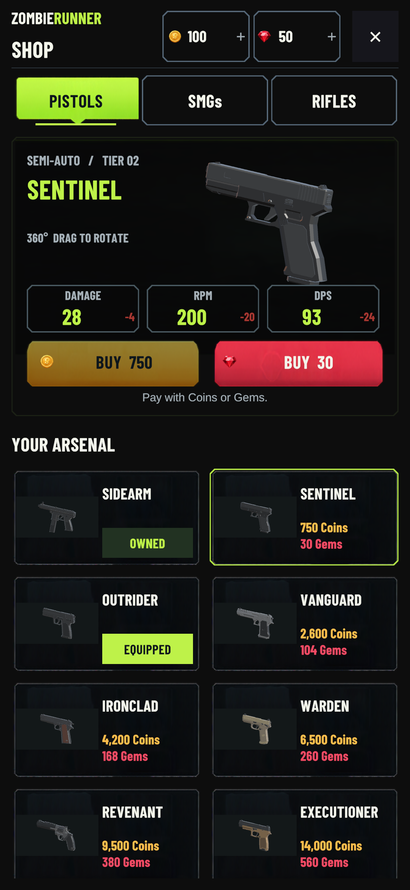

# ZombieRunner

**A Unity 6 zombie-themed action game prototype with a configurable weapon system, in-game economy, and mobile-oriented interface.**


**Developer:** [Tudor Mirea](https://github.com/tudrm)  
**Project status:** In development; tested primarily in the Unity Editor.

## Overview

ZombieRunner is a personal game-development project built with **Unity and C#**. It combines gameplay systems with a growing collection of interconnected features: weapon configuration, a shop and equipment flow, persistent player data, scoring, and responsive menus.

I use this project to practice **software development, system integration, debugging, and AI-assisted programming**. Rather than treating generated code as a finished solution, I define requirements, review the proposed changes, test them in Unity, and iterate when functionality or user experience needs improvement.

## Screenshots

| Main menu | Weapon shop |
|:---:|:---:|
|  |  |

*Screenshots are from Unity Editor verification. They are not evidence of a released mobile build.*

## Features

- **Configurable weapons:** a catalog of 20 weapons organized into **Pistols, SMGs, and Rifles**, with configurable damage, fire rate (RPM), prices, and derived DPS displayed in the shop.
- **Weapon ownership and equipment:** buying, equipping, equipped-state feedback, and protection against charging twice for already owned items.
- **In-game economy:** separate **Coins** and **Gems** balances, with an interface for available weapons and currency offers.
- **Persistent game state:** selected weapon, ownership, balances, settings, and high score are managed through Unity's `PlayerPrefs`-based systems.
- **Game flow and scoring:** a main menu, gameplay-scene transition, scoring, game-over handling, restart, and return-to-menu actions.
- **Responsive UI:** menus built with Unity UI and TextMeshPro, including layouts reviewed at multiple portrait and tablet resolutions.
- **Settings:** separate sound-effects and music controls with saved preferences.

> **Prototype limitation:** The real-money Gems offers are UI previews only. No live payment processing is implemented.

## Technologies and approach

| Area | Tools / concepts |
|---|---|
| Engine and language | Unity **6000.3.6f1**, C# |
| UI | Unity UI (uGUI), TextMeshPro, reusable UI components |
| Data and state | ScriptableObject-based configuration, `PlayerPrefs` |
| Development workflow | Git, GitHub, OpenAI Codex-assisted implementation and iteration |
| Testing | Unity Editor play-mode checks, regression checklists, multi-resolution layout reviews |
| Visual design | Canva-based UI references adapted into interactive Unity components |

### How I used AI coding assistance

A major learning goal of this project is **human-directed AI-assisted development**:

1. **Specify:** translate a desired feature into concrete requirements and constraints.
2. **Implement:** use OpenAI Codex to help develop or modify C# scripts and Unity components.
3. **Integrate:** connect changes to existing scenes, references, menus, and gameplay systems.
4. **Verify:** test interactions and persistence, inspect unexpected behavior, and check for regressions.
5. **Iterate:** refine the implementation based on actual Editor results rather than accepting generated output at face value.

Examples include the integration of the weapon shop, preservation of player state during UI changes, and responsive main-menu layouts. The repository also contains implementation notes and verification reports documenting these iterations.

## Technical highlights

Some useful entry points for reviewing the implementation:

- [`Assets/WeaponCatalog.cs`](Assets/WeaponCatalog.cs) — weapon definitions and catalog structure.
- [`Assets/WeaponManager.cs`](Assets/WeaponManager.cs) — gameplay weapon handling.
- [`Assets/ShopManager.cs`](Assets/ShopManager.cs) — shop interactions, purchases, and equipment state.
- [`Assets/ShopPresentation.cs`](Assets/ShopPresentation.cs) — the shop's presentation layer.
- [`Assets/MainMenuManager.cs`](Assets/MainMenuManager.cs) and [`Assets/MainMenuPresentation.cs`](Assets/MainMenuPresentation.cs) — menu navigation and responsive presentation.
- [`Assets/GameManager.cs`](Assets/GameManager.cs) and [`Assets/ScoreManager.cs`](Assets/ScoreManager.cs) — game-over flow and scoring.

The project keeps evolving, so individual systems may still be refactored or expanded.

## Testing and verification

I keep implementation notes and Unity Editor checks alongside the project:

- The [shop implementation report](SHOP_CANVA_IMPLEMENTATION.md) records **95 passing functional/regression checks** for that implementation stage, including weapon selection, purchase and equip behavior, state preservation, and UI interactions.
- The [main menu report](MAIN_MENU_CANVA_IMPLEMENTATION.md) documents navigation checks, UI feedback, and layout reviews across five viewport sizes.
- The [shop and settings guide](SHOP_GUIDE.md) outlines steps for manually exploring key features.

These are **project-level Editor checks**, not a claim of an independently audited automated test suite. Physical-device testing, performance benchmarking, and a production mobile release have not been confirmed.

## Run the project locally

1. Install [Unity Hub](https://unity.com/download).
2. Install the Unity Editor version listed in [`ProjectSettings/ProjectVersion.txt`](ProjectSettings/ProjectVersion.txt): **6000.3.6f1**.
3. Clone the repository:

   ```bash
   git clone https://github.com/tudrm/ZombieRunner.git
   ```

4. In Unity Hub, choose **Add project from disk** and select the cloned `ZombieRunner` folder.
5. Open `Assets/Scenes/MainMenu.unity` in the Unity Editor and enter **Play Mode**.
6. Explore **Shop**, **Settings**, and **Play**. For implementation-specific test scenarios, see [`SHOP_GUIDE.md`](SHOP_GUIDE.md).

**Note:** This is an evolving Unity project. Some third-party packages or assets may need to be resolved by Unity on first launch, and not every gameplay system has been validated on a physical device.

## Current limitations and next steps

- Continue refining the equipment/locker experience and game balance.
- Expand hands-on gameplay and end-to-end regression testing.
- Test performance, input, and layouts on physical mobile devices.
- Prepare a short gameplay demonstration and a validated distributable build.

## Project documentation

- [Main menu implementation and checks](MAIN_MENU_CANVA_IMPLEMENTATION.md)
- [Shop implementation and checks](SHOP_CANVA_IMPLEMENTATION.md)
- [Shop and settings testing guide](SHOP_GUIDE.md)

## About the developer

I'm **Tudor Mirea**, an Economic Cybernetics graduate and current **Natural Language Processing (NLP)** master's student, interested in software engineering, data, and practical AI applications. This project is part of my hands-on learning portfolio, especially my work with AI coding assistants and software verification.

**GitHub:** [github.com/tudrm](https://github.com/tudrm)

---

**Asset and licensing note:** This repository contains project assets and may include third-party materials with their own terms. Check the relevant licenses before reusing or redistributing assets. Public repository visibility should not be interpreted as a general license to reuse the project.
